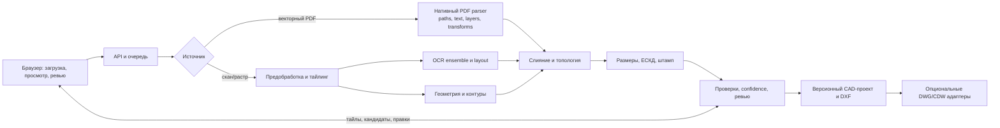

# Инженерный план: точная онлайн-реконструкция 2D-чертежей

> **Актуальное архитектурное решение (22.11.2026): [ТОЛЬКО GitHub Pages + клиентские вычисления](STATIC_PAGES_ARCHITECTURE.md).** Все упоминания в этом историческом плане облачного W2, серверных OCR/API/очередей, SaaS, аренды GPU и многоарендаторного хранилища **отменены**. Продукт работает целиком в браузере; усиленные пакеты скачиваются пользователем по требованию, локальный Ultra необязателен и запускается только на его ПК. Технические требования геометрии, размеров, ЕСКД, экспертизы и тестов сохраняются. [Новая активная дорожная карта](../ROADMAP.md).

Статус: целевой технический план геометрии/ЕСКД (облачная часть W2 отменена); W1–W6 частично реализованы и протестированы на синтетических данных (см. [текущий статус](IMPLEMENTATION_STATUS_2026-11-22.md)). Связанная задача: [#2](https://github.com/kappamaag-crypto/CadRecon/issues/2). Обновлено: 2026-11-22 (онлайн-приоритет и архивный аудит).

## Цель и границы результата

CadRecon должен стать веб-системой, которая принимает PDF, TIFF, PNG и JPEG, выделяет редактируемую 2D-модель чертежа, показывает степень достоверности каждого объекта и экспортирует проверенный результат. Приоритет — **онлайн-версия с максимальной практически достижимой точностью**; локальный Ultra-режим дополняет её для конфиденциальных, тяжёлых и сложных листов.

Результат: DXF как основной открытый формат; DWG — только через легально подключённый SDK/конвертер; CDW — через отдельный Windows-коннектор к лицензированному API КОМПАС-3D. До появления коннекторов пользователь получает проверенный DXF и понятный путь открытия/сохранения в целевой CAD.

Нельзя обещать 100% восстановление любого скана. Потерянные, размытые, перекрытые или неоднозначные элементы остаются кандидатами с причиной и confidence, а не превращаются в выдуманную геометрию. Производственный выпуск требует инженерного подтверждения и нормоконтроля.

## Текущее состояние

Клиент React/Vite уже извлекает пути и текст цифровых PDF через PDF.js, использует Tesseract.js и экспортирует DXF R2000. В `src/model.ts` есть LINE, POLYLINE, CIRCLE, ARC, TEXT, DIMENSION, оси, выноски, штриховки, таблицы, штамп и 12 типов ЕСКД. Локальный FastAPI backend добавляет PaddleOCR PP-OCRv5 и OpenCV LSD/Hough. Размерные цепи строятся как кандидаты из OCR и выносных линий.

Пробелы: нет объектной модели POINT/RECTANGLE, trim/extend/chamfer/fillet, устойчивого command history, ансамбля распознавания, графа топологии, серверной очереди, эталонных метрик и прямых DWG/CDW writer-ов.

## Целевая архитектура

### Отдельные конвейеры

1. **Векторный PDF:** проверять наличие paths/text, извлекать команды, матрицы, clipping, толщины, цвета и глифы непосредственно из PDF. Хранить `sourceObjectId`; не трассировать рендер. Растеризовать только неподдержанные фрагменты.
2. **Скан/растр:** контролируемый DPI, deskew/перспектива/фон, перекрывающиеся тайлы, координаты исходного листа. Создавать несколько гипотез и направлять спорные участки на ревью.
3. **Смешанный PDF:** сливать нативные и растровые результаты; нативному объекту дать приоритет, конфликт отображать пользователю.

## Онлайн-версия — первоочередная

- API-шлюз с проверкой типов/лимитов, антивирусной проверкой, короткоживущей загрузкой и идентификатором задания.
- Очередь с идемпотентностью, CPU/GPU лимитами, безопасным retry, прогрессом «страница → тайл → модель → проверка», отменой и приоритетами.
- Зашифрованное хранилище с TTL по умолчанию, явным удалением, tenant isolation и аудитом доступа. Никакого обучения на чертежах без отдельного согласия.
- Потоковый интерфейс: тайлы и структурированные кандидаты появляются по готовности; инженер принимает, отклоняет, объединяет или исправляет объект до окончания документа.
- Версия pipeline, модели, параметров, source/provenance и правок сохраняется с каждым объектом для воспроизводимости.
- Наблюдаемость без содержимого КД: latency, GPU/RAM, ошибки, ручные исправления, quality metrics; образцы — только opt-in.

## Конвейер максимальной точности

### Подготовка растра

Определять формат листа, рамку, DPI и качество. Строить обратимые варианты: оригинал, normalised contrast, бинаризация, удалённый фон. Исправлять skew/perspective по рамке и длинным линиям, сохраняя матрицу. Низкое качество направлять в Ultra/ручную очередь, а не повышать confidence.

### OCR, таблицы, штамп

- Browser OCR остаётся приватным quick-путём; в online accurate — серверный детектор, ориентация, полигональные bbox и распознавание.
- Основной кандидат: PaddleOCR 3.x / PP-OCRv5 `ru`/East-Slavic для русского, цифр и латиницы; CPU/GPU profiles. Метрика модели не подменяет benchmark CadRecon.
- Добавить второй независимый движок/модель как опциональный ensemble и domain-specific дообучение только на легально размеченных данных. Хранить варианты, score и правило выбора; конфликт — человеку.
- Отдельно извлекать таблицы, штамп, дроби, `Ø`, `±`, `°`, шероховатость, резьбы, GD&T. Не заменять неизвестный знак похожим Unicode без флага сомнения.
- Языковую модель применять только для ранжирования/нормализации, никогда для дорисовки цифр или размеров.

### Геометрия и топология

- Сегментация: текст, размерные/выносные, осевые, контур, штриховка, рамка/штамп, изображения, шум. Маскировать текст консервативно.
- Детекторы: LSD/Hough для кандидатов, контуры/subpixel fitting, RANSAC прямых/окружностей, arc/ellipse fitting, junction detection. У каждого примитива — residual, источник, confidence.
- Сводить фрагменты в planar graph: adaptive snap, collinear merge, intersections, gaps, duplicates, tangency, closed loops. Граф — основа trim/extend и проверок.
- Вводить типы: POINT, LINE, POLYLINE, RECTANGLE, CIRCLE, ARC, ELLIPSE, SPLINE, HATCH, BLOCK/INSERT. Полилиния сохраняет дуговые сегменты.
- Не объединять штриховку, размеры и контур только из-за касания пикселей: учитываются тип линии и семантический слой.

### ЕСКД и размерные цепи

Сопоставлять текст, стрелки, размерные и выносные линии через граф близости и правила направления. Создавать кандидаты линейного, углового, радиального, диаметрального, базового и координатного размеров; хранить указанное/измеренное значение, допуск, базу, связи и статус `candidate/reviewed/verified/rejected`.

Контроль: замкнутость цепи, сумма составляющих/общий размер, калибровка, дубли/противоречия, `Ø/R/M`, стрелки/выноски, пересечения текста, обязательные поля штампа и ЕСКД-наборы. Правила оформить версионируемым ruleset с тестовыми примерами; без молчаливого исправления чертежа.

## Полный 2D-редактор

Перейти к типизированным примитивам, стилям, слоям, блокам, связям и undoable-командам. Каждый объект: UUID, геометрия, стиль, provenance, confidence и audit trail. Добавить object snaps: endpoint, midpoint, center, quadrant, intersection, perpendicular, tangent, nearest; polar/ortho, сетку и ввод координат.

| Группа | Инструменты |
|---|---|
| Создание | point, line, polyline с дугой, rectangle, polygon, circle, arc (3-point/center-start-end), ellipse, spline, hatch, text/MTEXT, table, block, image underlay. |
| Изменение | move, copy, rotate, mirror, scale, offset, stretch, array, align, explode/join, свойства, слои. |
| Точная геометрия | trim, extend, break, chamfer, fillet, divide, lengthen; касания, closed polylines, undo/redo. |
| Аннотации | linear/aligned/angular/radius/diameter/ordinate dimensions, leaders, center marks, axes, допуски, шероховатость, сварка, сечения/выноски, штамп. |
| Проверка | measure, inquiry, selection filters, «до/после», confidence/conflicts, audit report. |

Команды сначала должны быть детерминированными на ручной геометрии, затем применяться к подтверждённым авто-кандидатам.

## Ultra: локальный сервер в выбранной папке

Ultra использует тот же API, но хранит и обрабатывает оригиналы локально, в native resolution, с тяжёлыми моделями/GPU. Это дополнение к приоритетному online accurate, а не публичный сервис.

1. Кнопка «Установить Ultra» скачивает подписанный bootstrapper/manifest и предлагает выбрать папку, CPU/GPU-профиль и порт.
2. Bootstrapper проверяет место, права, GPU/driver и хеши; создаёт изолированный runtime в выбранной папке, устанавливает pinned models и локальный секрет.
3. По умолчанию служба доступна только на `127.0.0.1`, содержит health/version/update/uninstall. LAN требует явного TLS, токена, allowlist и предупреждения.
4. Браузер связывается через localhost, CORS allowlist и одноразовый pairing token; передача листа подтверждается явно. Offline model bundle и diagnostic bundle обязательны.
5. Профили: Quick (browser), Online Accurate (очередь + ensemble), Ultra Local (tiled native resolution + GPU + privacy).

## Форматы

DXF — первый нормативный экспорт: units, UCS, layers, linetypes, blocks, MTEXT, DIMENSION/STYLE, HATCH, Unicode и provenance в безопасных extension data. Нужны round-trip/visual tests с независимыми читателями и AutoCAD/КОМПАС.

DWG нельзя реализовать переименованием DXF: заранее принять ADR о лицензировании, версиях и SDK/converter. CDW также закрыт: выделить Windows adapter к установленному лицензированному КОМПАС-3D/SDK и contract tests. В online режиме CDW-работа идёт локальному коннектору, не в неявный сторонний сервис.

## Внешние решения

| Решение | Проверенный фокус | Роль в CadRecon |
|---|---|---|
| Werk24 | API возвращает структурированные размеры, допуски, GD&T, материалы и штамп. | Опциональный платный adapter для сверки семантики; не источник геометрии. |
| DrawScan AI | Распознавание/структурирование чертежей и поиск по архиву. | Референс поиска; интеграция только после API/лицензии/benchmark. |
| CADSoftTools | Нативный PDF→editable DWG/DXF; raster в документации остаётся изображением. | Benchmark/возможный licensed option для vector PDF, не векторизатор сканов. |
| Digi-Keys | Браузерные PDF→DXF и DWG/DXF, заявлена локальная обработка. | Privacy/UX baseline; качество и условия проверить отдельно. |
| i2PDF | Онлайн PDF→DWG/DXF и предупреждение о зависимости от качества/структуры. | Smoke-baseline, не backend для закрытых КД. |
| Linnk AI | PDF summary/translation/mind maps, не CAD reconstruction. | Не использовать как движок геометрии/OCR. |
| iLovePDF | Универсальный PDF/OCR без CAD-реконструкции. | Только подготовка PDF/растра, не CAD-объекты. |

Внешние интеграции выключены по умолчанию, требуют согласия, раскрывают регион/TTL/цену и имеют contract tests.

## Качество и тесты

Собрать закрытый, юридически чистый, версионируемый corpus: native PDF, хорошие/плохие сканы, mixed pages, русский/латиница, ЕСКД, штампы, таблицы, резьбы, допуски и adversarial cases. Разделить train/validation/test по семействам и организациям.

- OCR: CER/WER, exact-match критических токенов, bbox precision/recall.
- Геометрия: primitive precision/recall, endpoint/center/radius/angle error в мм, topology F1, ложные соединения.
- Семантика: precision/recall/F1 размеров, цепей, ЕСКД и штампа; отдельное «не предложил ложное значение».
- Экспорт: DXF parsing, entity/layer/style counts, round-trip, visual pixel diff, открытие в целевых CAD.
- UX: доля принятых кандидатов, правки на лист, время до verified DXF, понятность confidence.
- Reliability/security: limits, cancellation, retry, tenant isolation, отсутствие содержимого в логах.

Пирамида: unit (PDF/coords/fitting/rules/DXF/CAD commands), property/fuzz, golden regression, API/queue/storage/Ultra integration, E2E «upload → review → edit → audit → export → reimport», manual acceptance инженером и нормоконтролёром. Релиз сравнивается с неизменяемым baseline; разные gates для vector PDF и scans. Одна маркетинговая «accuracy» запрещена.

## Этапы и gates

| Этап | Результат | Gate |
|---|---|---|
| 0 | ADR форматов, privacy, corpus, baseline, SLO. | Нет метрик — нет режима Accurate. |
| 1 | Векторный PDF: paths/text/layers/provenance, DXF regression. | Эталоны + два CAD-приёмника. |
| 2 | Online: API, queue, TTL, progress, review, audit, observability. | Security/load/recovery tests. |
| 3 | Скан: preprocessing, tiled OCR/geometry ensemble, topology, uncertainty UX. | Лучше baseline без роста опасных false positives. |
| 4 | CAD-core: полный 2D, snaps, commands, undo, styles/blocks. | Deterministic geometry/property/E2E tests. |
| 5 | ЕСКД/размеры: ruleset, chains, audit. | Critical semantic precision + no-silent-correction. |
| 6 | Ultra installer: folder choice, signed bootstrapper, CPU/GPU, offline. | Fresh install/uninstall/update/privacy tests. |
| 7 | DWG/CDW adapters и лицензии. | Contract tests по версиям CAD. |
| 8 | Pilot: flags, feedback, rollback. | Quality/security/cost agreed. |

Этапы 2–4 допускают частичную параллельность после этапа 0. CDW не блокирует DXF-ценность. Каждый этап оформляется отдельными issues, связанными с [#2](https://github.com/kappamaag-crypto/CadRecon/issues/2), с владельцем, артефактами, метрикой и демонстрацией.

## Риски

- Лицензии DWG/CDW — решить до обещания форматов; не reverse-engineer закрытые форматы.
- GPU/API cost — квоты, лимиты, quality profile до постановки в очередь.
- Конфиденциальность — cloud opt-in, Ultra для закрытых КД, TTL/шифрование.
- Ложная уверенность — candidates, confidence/reason, запрет auto-verified для рисковых объектов.
- Данные — независимая разметка/adjudication; тестовый набор не обучает модели.
- Операции — pinned versions, SBOM, signed updates, health checks, rollback.

## Источники (проверены при подготовке)

- [PaddleOCR PP-OCRv5](https://paddlepaddle.github.io/PaddleOCR/v3.1.0/en/version3.x/algorithm/PP-OCRv5/PP-OCRv5_multi_languages.html), [OCR pipeline](https://paddlepaddle.github.io/PaddleOCR/main/en/version3.x/pipeline_usage/OCR.html).
- [Werk24 API](https://www.werk24.io/) и [GD&T docs](https://docs.werk24.io/features/gdts.html).
- [DrawScan AI](https://duc-technologies.ru/drawscanai).
- [CADSoftTools online](https://cadsofttools.com/pdf-to-dwg-online/) и [raster limitation](https://es.cadsofttools.com/help/en/pdf_to_dwg_converter.htm).
- [Digi-Keys tools](https://digi-keys.ru/tools/), [i2PDF](https://www.i2pdf.com/pdf-to-cad), [Linnk AI](https://linnk.ai/fi/tools/pdf-to-mindmap/), [iLovePDF](https://www.ilovepdf.com/help/documentation).
- [КОМПАС-3D/SDK v24](https://help.ascon.ru/KOMPAS/24/docs/ReadMe.pdf).

Перед интеграцией повторно проверить API, лицензию, регион/TTL данных и benchmark на собственном наборе.

---

## Дополнение 2026-11-22 — инженерная спецификация online-first

**Приоритет решений:** P0 = качественная и бесплатная/доступная **онлайн-версия** с максимальной контролируемой точностью; P1 = профессиональные 2D-инструменты и ЕСКД; P2 = локальный Ultra и закрытые форматы. Это расширение исходного плана, а не замена уже работающих функций. Исполнение/рефакторинг/создание программных модулей в рамках этой задачи **не проводятся**.

Связанные документы: [исследование текущих решений](TECHNOLOGY_EVIDENCE_2026-11-22.md), [разбор двух архивов](ARCHIVE_FEATURE_AUDIT.md), [нормы и тестовые gates](VALIDATION_AND_TEST_PLAN.md), [ROADMAP](../ROADMAP.md), [главный issue #2](https://github.com/kappamaag-crypto/CadRecon/issues/2), [текущий issue по пробелам ЕСКД #1](https://github.com/kappamaag-crypto/CadRecon/issues/1).

### A. Точный аудит исходного кода `main` (срез 2026-11-22)

| Узел | Фактическая реализация | Инженерный долг и приоритет |
|---|---|---|
| [`src/pdf.ts`](../src/pdf.ts) | PDF.js operator list + `save/restore/transform/constructPath`, текст и JPEG-подложка, до 40 листов/90 МБ; прямые извлекаются как `line`; cubic Bézier **разбивается на 8 прямых**; для некоторых PDF есть потолок 30 000 отрезков | **P0:** сохранять исходные типы кривых, paint/clip/style/глифы; не терять молча всё после cap. Первичная единица листа — пиксели render viewport, **не CAD мм**; нужен единый реестр координат |
| [`src/trace.worker.ts`](../src/trace.worker.ts), [`src/vectorize.ts`](../src/vectorize.ts) | Приближённый Hough по границам, грубая проверка отдельных окружностей и объединение; детальная обработка до 26 Мп/8500 px, перекрытие тайлов | **P0:** детектирование со свободным углом, точный fitting, топология, нормализация confidence, слияние на границах тайлов; на больших листах качественно не понижать разрешение без явного предупреждения |
| [`src/ocr.ts`](../src/ocr.ts), [`src/textRepair.ts`](../src/textRepair.ts) | Tesseract.js и исправление частых повреждений PDF-кодировки | **P0:** инженерные знаки/русский/дроби/повёрнутые размеры, варианты OCR, source bbox и критические символы. Привести все confidence к документированному диапазону 0..1 (у Tesseract часто проценты) |
| [`src/model.ts`](../src/model.ts) | `Kind` включает line, polyline, circle, arc, text, dimension, axis, leader, hatch, table, stamp, eskd | **P1:** отсутствуют самостоятельные `point`, `rectangle`, `ellipse`, `spline`, `block` и управляемые геометрические constraints/relationships, единый Command API/транзакции/версионированная миграция |
| [`src/dimensions.ts`](../src/dimensions.ts), [`src/eskd.ts`](../src/eskd.ts) | Семантические кандидаты размерных цепей и 12 шаблонов, отдельный UI проверки, `verified=false` | **P0/P1:** angled/radial/ordinate, арочные размеры, стрелки, GDT/weld, контроль общей размерной цепи, версии стандартов, недопущение автоматических исправлений |
| [`src/dxf.ts`](../src/dxf.ts) | Текстовый DXF R2000, DIMENSION, HATCH, ЕСКД INSERT; CI независимо разбирает `ezdxf` | **P0/P1:** проверить единицы, типы кривых, корректную редактируемость и потери при round-trip; отдельно DWG/CDW лицензируемые адаптеры |
| [`backend/recognizer.py`](../backend/recognizer.py), [`backend/server.py`](../backend/server.py) | FastAPI `/health`, `/recognize`, PP-OCRv5+LSD+Hough/контуры, 35 МБ/42 Мп; токен опционален | **P0/P2:** это **локальный прототип**, не онлайн-сервис общего доступа: добавить очередь/аутентификацию/изоляцию, тайлинг и валидацию до декодирования. При пустом токене не выставлять сервис в сеть |

Вывод аудита: **уже реализованными нельзя повторно считать** новый серверный online-accurate контур, графовую реконструкцию, полное 2D CAD-редактирование, нормы-валидатор и нативные DWG/CDW. Нельзя помечать эти позиции как `done` только по README/UI.

### B. Три режима с приоритетом онлайн

| Профиль | Где исполняется | Назначение | Условие |
|---|---|---|---|
| **Quick Local Web** | Браузер, GitHub Pages, Web Workers/WASM | Доступен бесплатно без установки, точный парсинг векторного PDF, базовый OCR/обводка, CAD review и DXF | Документ **не покидает браузер**. Проверить PoC [PaddleOCR.js](https://github.com/PaddlePaddle/PaddleOCR/blob/main/docs/version3.x/inference_deployment/cross_platform/browser.en.md) как перспективную локальную OCR-альтернативу |
| **Online Accurate — ГЛАВНЫЙ ПРОДУКТ** | Браузер + выделенный защищённый сервер с CPU/GPU и задачами | Весь набор векторных PDF/растров, качественный ensemble, тайлинг без потери исходных пикселей, граф топологии, ЕСКД, подсказки и редактирование | Явное согласие на отправку документа, TTL, удаление, стоимость/лимиты до запуска, контроль качества и fallback Quick |
| **Ultra Local** | Устанавливаемый на выбранный путь Windows 11 server/agent | Тяжёлые и конфиденциальные листы, офлайн-модели, необязательный GPU и интеграция КОМПАС SDK | По желанию; **не должен блокировать или ухудшать Online Accurate** |

Онлайн-сервис проектировать **отдельно от текущего FastAPI локального прототипа** (через переиспользуемое алгоритмическое ядро). Статический GitHub Pages сам не запускает PaddleOCR/Python на сервере. Если бюджет облака ограничен, начать с бесплатной Quick Web + CPU Online Accurate при явно обозначенных квотах; GPU и тяжёлый ensemble включать по профилю и оценке трудоёмкости листа. Не применять платный внешний OCR по умолчанию.

### C. Каноническая модель CAD и координаты (P0, до новых алгоритмов)

**Обязательные системы координат**: PDF user space (pt, page rotation/crop/media box) → image raster (px, DPI) → page/paper space (мм) → model space (мм, отдельный масштаб вида) → CAD UCS/WCS. Хранить исходные и обратимые матрицы `M_pdf_to_page`, `M_image_to_page`, `M_page_to_model`, параметры калибровки, размерность и погрешность. Не путать 1:100 при печати с изменением геометрии модели.

Сущность должна содержать `uuid`, тип и точные параметры (для circle центр+радиус, для ARC центр+направление+углы, для SPLINE узлы/контрольные точки), слой/стиль, топологические связи, `sourceDocumentHash/pageIndex/operatorId|bbox`, transform/version, confidence по категориям, `reviewStatus` (unreviewed/accepted/rejected/edited), журнал аудита. **`verified` не должен автоматически наследоваться от детектора**, а ручной объект тоже может быть ошибочным.

Строго разделить: `SourceEvidence` (что реально увидено), `Candidate` (гипотеза), `CADGeometry` (редактируемая сущность), `DimensionSemantic` (значение/допуск/ссылки), `ReviewDecision`. Не проводить разрушительное преобразование исходного PDF в один гигантский слой линий.

**Точность и неопределенность:** без известного размера или документированного масштаба абсолютный миллиметрический размер скана *неизвестен*. Проводить калибровку минимум двумя независимыми контрольными размерами; оценивать X/Y stretch, skew, перспективу и локальную деформацию. Ошибки калибровки показывать численно. При конфликте размеров реконструировать не «по догадке», а предложить корректировку пользователю.

### D. Native vector PDF — без потерь, потом семантика (P0.1)

1. Детектировать для каждой страницы тип `vector/mixed/raster` по реальным операциям PDF, а не по расширению файла.
2. Читать path paint operators с графическим состоянием: матрицы, clipping path, stroke/fill, dash/line cap/join, толщину, цвета/transparency; вложенные Form XObject/шрифты. Группировать draw operations с уникальными ссылками на первоисточник.
3. **Кривые сохранять параметрически:** cubic Bézier → SPLINE/эквивалент без упрощения; только подтвержденный по геометрическим инвариантам fit может создавать ARC/CIRCLE (погрешность показывать). `rectangle` восстанавливать прямоугольником/закрытой LWPOLYLINE по смыслу, а не четырьмя независящими сегментами.
4. Текст: разбирать text matrices, bbox, Unicode/ToUnicode, fallback для SHX/Type3 outlines; OCR векторизированных глифов использовать только при необходимости и сохранять конфликтные альтернативы. Размерный текст отдельно от геометрии.
5. Отделять рамку, штамп, размеры, осевые, выноски, штриховки, основной контур и строительные виды с помощью классификации *после* восстановления paths. Склеивать сегменты только при проверенной коллинеарности/связности; не удалять визуально перекрывающиеся разные сущности.
6. Многолистовые PDF: сохранение ориентации и crop/bleed box, листовая карта, checkpoint и повторное открытие; при лимите/потере обязателен отчет об усеченных объектах.

**Gate:** тесты множества независимых оригинальных PDF, скрин-сравнение и независимое CAD-вскрытие. Не считать точность отрисовки эквивалентом точности измерений.

### E. Scan / raster — максимальная практическая точность онлайн (P0.2)

**Вход:** оценка DPI, размытия, штриха, битой страницы/неодинаковых масштабов, цветности, потери углов листа. Если несоответствие техническому порогу — карточка `Low source quality` вместо ложного «успех 99%».

1. Подготавливать **набор** недеструктивных представлений: original RGB/grayscale, CLAHE, Sauvola/adaptive threshold, morphology (тонкие линии отдельно от букв), reversible deskew/dewarp и цветовые маски. Никогда не удалять оригинальную подложку.
2. Обрабатывать **native-resolution tiles** с перекрытиями, согласованием координат, обнаружением повторов и сохранением тонких линий на границах. Adaptive tile size по RAM/VRAM; для A0/600dpi — server streaming, не браузерный downscale.
3. Разделять semantic classes: контур/скрытая/осевая/размерная/выносная/штриховка/таблица/рамка/текст/растровый знак/шум. Не маскировать буквы впритык к стрелкам; текстовый bbox хранить даже если общий detector ошибся.
4. Геометрия: объединить LSD, HoughP, edge/skeleton tracing, contours + RANSAC/least squares robust fit (circle/arc/ellipse), детектор стрелок/узлов/разрывов и multi-scale segmentation; строить граф пересечений и связности, явно моделировать T-junction/crossing/bridge. Никаких скрытых соединений в местах пересечения.
5. OCR ensemble на кириллице/латинице/цифрах/суперскриптах/Ø/R/M/±/°/⌀/шероховатости, 0/О/6/8/1/I, допусках в две строки, вертикальном/повернутом тексте. Benchmark PaddleOCR PP-OCRv5 **против PP-OCRv6**, браузерного PaddleOCR.js и Tesseract, не повышать «достоверность» лишь из-за второй модели. Порог и disagreement margin настраиваемы.
6. Инженерная семантика: распознать прямоугольный/косоугольный размер, радиус, диаметр, базовые, ординатные, цепные, посадки/допуски, связи выносок и стрелок с контурами. Для неоднозначностей хранить top-k без автоматической подстановки.
7. Глобальная оптимизация графа геометрии с ограничениями: continuity/parallel/perpendicular/tangent/concentric/equal spacing только когда исходные данные подтверждают, а не вместо видимой геометрии. Исходный measured geometry и adjusted suggestion сохранить раздельно.
8. Confidence разделить на OCR/geometry/topology/scale/semantic и **калибровать на реальных эталонах**. При снижении качества данных система должна чаще воздерживаться (`abstain`), а не выдавать неизвестную линию или цифру как точный факт.

**Не обещать** восстановление невидимых или стертых элементов: если исходный скан не содержит достаточной информации, правильный исход — видимая неопределенность и ручное дочерчивание. Требуемые метрики и условия испытаний: [VALIDATION_AND_TEST_PLAN.md](VALIDATION_AND_TEST_PLAN.md).

### F. Полнофункциональный 2D CAD — требования к командам (P1)

**Примитивы, создание**: POINT (координата, привязка), LINE (по двум точкам, длина/угол), XLINE/RAY, POLYLINE/LWPOLYLINE (замкнутая, bulge дуги, толщины, добавление/удаление вершин), RECTANGLE (по диагонали, центр+размеры, скругленный), POLYGON (число сторон, вписанный/описанный), CIRCLE (центр+R/D, 2/3 точки), ARC (3 точки, центр+радиус+углы, касательные), ELLIPSE/elliptical arc, SPLINE/Bézier, MULTILINE, HATCH (контуры/острова/шаг/угол), TEXT/MTEXT, BLOCK/INSERT, TABLE, DIMENSION, LEADER, AXIS/CENTERMARK, условные обозначения и основная надпись.

**Редактирование:** SELECT (рамка crossing/window, multi-select), MOVE/COPY/ROTATE/SCALE/MIRROR/STRETCH, OFFSET (расстояние/сторона), TRIM/EXTEND (с пересечениями дуг/сплайнов, выбор стороны), BREAK/BREAKATPOINT, JOIN/EXPLODE, FILLET (R=0 и R>0; линия↔линия/дуга/окружность), CHAMFER (две длины или длина+угол), ARRAY (rectangular/polar), PEDIT (перенос вершин, закрытие, конверсия), DELETE, ALIGN, LENGTHEN, MATCHPROPERTIES, LAYER operations, GROUP/UNGROUP, CHANGE ZORDER, EXPORT SELECTION. Семантика команды должна быть детерминирована и возвращать preview до commit.

**Точность ввода/управления:** абсолютные X,Y; относительные @dx,dy; полярные @length<angle (в UI ввод отображать безопасно); мм/градусы с локалью; ORTHO/POLAR и temporary tracking, dynamic input, точные object snaps END/MID/CENTER/QUAD/INTERSECTION/PERP/TANGENT/NEAREST/APPARENT, включаемая сетка с configurable шагом, привязка при высоком зуме, Zoom extents/selection, GPU/Canvas renderer с zoom-to-cursor. Передачу значений из OCR в геометрию выполнять только через подтверждение.

**Редактор размера:** линейный (aligned/horizontal/vertical), угловой, радиальный, диаметральный, ординатный, базовый, цепной; стиль размерной линии/стрелки, вынос, шрифт, текстовое override с provenance, пределы отклонений/посадки, ассоциативность к точкам/линиям. Масштаб изображения и размерный стиль — разные понятия.

**Внутреннее CAD-ядро:** command pattern `execute/preview/undo/redo`, транзакции, immutable snapshots/diff, serializable operation log, numerically robust predicates, отдельная geometry library с tolerance в мм и настраиваемым pixel-viewport tolerance. Общая сущность/констрейнты/слои/блоки используют один источник истины и версионированную миграцию проекта.

**Интерфейс без перегруза:** первичная панель «Выбрать / Линия / Полилиния / Прямоугольник / Окружность / Дуга / Размер / Подрезать / Сопряжение / Фаска»; остальные операции в раскрываемых группах и контекстном меню. Горячие клавиши, поле команд, инструментальные подсказки, мгновенный Undo; адаптивные панели для узкого экрана, но высокоточная работа рекомендована на ПК.

### G. Размерные цепи, обозначения ЕСКД и нормоконтроль (P0/P1)

- Хранить размер как `value+units+tolerance/fit+orientation+dimensionGeometry+sourceEvidence+ruleVersion`, а не просто TEXT. Механизм association связывает геометрию со стрелками, выносными и текстом. Допускаются несколько интерпретаций и `unknown`.
- Цепи по базам и последовательные: строить направленный граф от начальной базы до конца; проверять **closure** `sum(segment values)-overall value` с единицами/знаками и допусками; предупреждать о пропуске звена, перепутанной единице, дублирующей позиции, несоответствии положения/размера. При разных видах, масштабах и развертках — требовать разрешения инженера.
- Разграничить `visual geometry` и `dimensioned nominal geometry`. Нельзя автоматически вытягивать фактические линии под OCR-число и тем более молча менять значение размера.
- Нормоконтроль по **версионируемому** ruleset: форматы/основная надпись, масштаб, линии/шрифты/штриховка, размеры/предельные отклонения, виды/разрезы/сечения, осевые, сварные, шероховатость, геометрические допуски и обозначения, спецификации и техтребования.
- Особое внимание изменениям 2026: официальный Росстандарт указывает для [ГОСТ Р 2.307-2026](https://protect.gost.ru/gost/details/eddb3107-58be-4811-b237-5ab1d0d4c4d5) дату действия **2027-10-01 с правом досрочного применения**. Модель правил должна поддерживать дату, профиль организации и предыдущую редакцию. Аналогично проверить свежие ГОСТ Р 2.302/2.303/2.305/2.306/2.309-2026; **не считать все редакции одновременно действующими**.
- Каждое нарушение показывать `error/warning/informational/unverifiable`, стандарт/пункт (после легальной проверки текста), объект, PDF-фрагмент, предлагаемый способ исправления и подпись проверяющего. Автоматическое «соответствует ЕСКД» без полноценного нормоконтроля запрещено.
- После корректировки создать **отчет исходное→обнаруженное→подтвержденное** с датой, версиями правил, списком оставшихся неопределенностей и ссылкой на исходный лист.

### H. Online API, интерфейс принятия кандидатов и безопасность (P0)

**Backend shape:** ingest & preflight → metadata job manifest → isolated PDF/raster parsers → OCR/geometry workers → fusion/topology/semantic → review snapshots → exports. REST для управления задачами, SSE/WebSocket для прогресса и фрагментов, отдельное store проектов, очередь Redis/RQ/Celery или эквивалент после ADR. Не привязывать интерфейс к конкретному OCR SDK.

**Гарантии:** контроль PDF magic/MIME/page count/font/image decompression bombs *до* тяжелого decode, worker limits, per-tenant quotas, rate limiting, жесткий TTL/удаление, шифрование, scoped URLs и токены, audit trail без содержимого КД, отключенное использование для обучения, защищенный pipeline извлечения и рендеринга. Обязательно показать «Этот лист будет передан на сервер» со сроком хранения и местом обработки; Quick Web остается полностью локальным.

**Online UX:** сверху постоянная строка загрузки/ошибки/неопределенности; слева листы и инструменты; центр — привязанные по координатам `Оригинал / Наложение / CAD / Разница`; справа вкладки `Кандидаты / Свойства / ЕСКД / Аудит`. Режим до/после поддерживает linked zoom, wipe slider, контрольные точки, микролупу и карту участков с высоким риском. При ошибке не заставлять пользователя скроллить к низу страницы. Быстрые решения: `Принять`, `Исправить`, `Отклонить`, `Не читается`, `Найти исходную линию`.

**Потоковый результат:** для A0 сразу открывать обзор/тайловый preview, затем новые кандидаты по страницам. Пользователь способен начать ревью до завершения полной обработки. Загрузка и OCR не удаляют ручные правки: result version + conflict resolver + undo.

**Надежность:** восстановление после перезагрузки вкладки/разрыва связи без потери уже принятых решений; отмена дорогостоящей задачи, идемпотентные job IDs; тест стоимости, throttling при нагрузке, source hash cache с учетом privacy.

### I. Ultra Local — установка «в одну кнопку» в выбранную папку (P2)

**Windows 11 first** (КОМПАС-3D v25 — Windows-коннектор); далее Linux CPU как отдельная цель. Инсталлятор `CadRecon Ultra Setup.exe` или подписанный MSIX по ADR, мастер **Выбрать папку** (например `F:\CadReconUltra`) и отдельные директории `app/models/cache/projects/logs` с возможностью выбрать `models` на другом диске. Поддержать пробелы, кириллицу, пути UNC только после проверки, права записи и свободное место. Без полномочий администратора использовать user-level installation, если возможно.

**Шаги мастера:** проверить Windows, CPU/ОЗУ/диск, необязательный NVIDIA GPU/драйвер/CUDA и совместимость runtime → предложить режим CPU (всегда рабочий) либо GPU (при подтвержденной поддержке) → подсчитать объем загрузки → установка фиксированных Python/runtime/моделей из подписанного bundle/зеркала с SHA256 → локальный `127.0.0.1` health-check → открыть веб-страницу и один тестовый синтетический лист → сохранить выбранные настройки. При отсутствии сети — офлайн-пакет с лицензиями/manifest, не незаметная скачка моделей.

**Профили:** Lite CPU (низкие RAM), Accurate CPU (тайлы/OCR ensemble), Ultra GPU (максимальное разрешение, тяжелая сегментация). Браузер и локальный API должны иметь один schema/version protocol. USB/SSD storage optional. Если GPU недостаточен — автоматическое безопасное переключение на CPU с явным предупреждением, без падения.

**Операции:** Start/Stop/Restart/Check, tray optional, локальные логи без чертежей, подписанное обновление, backup/restore проекта, uninstall с вопросом «оставить данные?», миграции и rollback. По умолчанию только loopback, токен для сетевого режима обязателен. Для веб-страницы на HTTPS проверить реальное взаимодействие с `http://127.0.0.1` в Chromium/Firefox, CORS/Private Network Access, preflight, сертификат/доверенный loopback bridge; **не обещать, что URL сам заработает у всех браузеров без интеграционного теста**. Доступ через LAN/Tailscale — отдельная opt-in настройка с TLS и аутентификацией.

**Особый статус CDW:** работающий локальный Ultra **сама по себе не означает** установленный КОМПАС или право записи CDW. Для нативного CDW потребуется отдельная проверенная связка с установленным лицензированным КОМПАС v25/SDK, согласованной разрядностью, типом документа и формальными contract tests.

### J. Форматы и управляемая потеря информации

- DXF — открытый приоритет, одна истинная CAD-модель для рендера, операций и экспорта; версия R2000/другая — по compatibility matrix. LINE/LWPOLYLINE/ARC/CIRCLE/SPLINE/ELLIPSE/TEXT/MTEXT/INSERT/HATCH/true DIMENSION где поддерживается. Проверять Unicode/кириллицу, лейауты, материалы, XDATA (не размещать секреты), единицы, ориентацию и styles.
- DWG — контракт лицензированного компонента; перед экспортом проверить license/version/restrictions. DXF→DWG с независимой проверкой, не маскировать переименованием.
- CDW — локальный Windows API коннектор/экспорт+импорт КОМПАС v25; журнал потерь и UI «не поддерживается здесь», если связка отсутствует.
- Пользователь получает **пакет проекта**: editable DXF, исходный/исправленный проект JSON c миграцией версии, PDF preview overlay, отчет unresolved/review log, при необходимости исходную подложку отдельным файлом и manifest версий.
- При неподдерживаемой сущности: fallback только в явно согласованный редактируемый примитив + loss report; если иначе нельзя — сохранить исходную подложку и предупредить, а не молча пропускать.

### K. Функции из архивов — отдельно от автоматического распознавания

Подробный источник: [ARCHIVE_FEATURE_AUDIT.md](ARCHIVE_FEATURE_AUDIT.md). **Важная граница:** ГАЛС работает с нативными объектами КОМПАС и сборочными связями, которых может не быть в PDF. Для CadRecon полезно **сохранить логику проверки**, но не имитировать исходные 3D-данные.

**Приоритет P1:** поиск/подсветка текста и символов на чертеже; аудит количества и параметров линий/полилиний/окружностей/дуг/эллипсов/прямоугольников; свод однотипных отверстий и радиусов; контроль повторных/пропущенных позиций; редактирование штампа с черновой корректировкой. **P2:** классификация деталей и стандартных изделий по проверенному справочнику; CSV/XLSX/PDF-отчеты; отдельная инвентаризация сварных швов/выносок и числа мест, версия стандарта/ссылка; пакетная структура проекта/экспорт; история ревизий. **Нативная синхронизация** спецификации/сборки — отдельно через SDK.

Архив `SearchTextApp` — только RAR5 с EXE, а не исходники; нельзя достоверно приписать ему пакетный поиск/замены. Идею полнотекстового поиска предложить **как самостоятельное требование**, но не обозначать функцией, доказанно скопированной из EXE.

### L. Последовательность работы, deliverables и DoD

| Wave | Приоритет | Что проектировать | Что предъявить на gate |
|---|---|---|---|
| **W0** | P0 | ADR data/privacy/licensing, canonical mm model, версии ЕСКД, разметка sealed corpus, baseline | Документы, список эталонов, измерения текущего кода; fail-closed для неопределенности |
| **W1** | **P0** | Lossless native vector PDF ingestion; текст, path semantics, transform; vector→DXF | Golden conversion + независимые CAD приёмники + измеренный path recall/precision |
| **W2** | **P0** | Online Accurate API/queue/storage + UI progressive preview/review + privacy | E2E upload→review→export; cancel/retry; security/load; стоимость на лист |
| **W3** | **P0** | Raster multiscale/tile + OCR benchmark v5/v6/js + topology + confidence | Стратифицированный benchmark, уменьшение рисковых FP, измеренное время исправлений |
| **W4** | P1 | 2D geometry engine + 30+ операций, слои/стили/сущности, transactional undo | Property/fuzz/geometry tests, UI E2E, redo deterministic |
| **W5** | P1 | Размерные цепи, ЕСКД ruleset, основной штамп, поиск/объектные отчеты из ГАЛС | Проверка по применимым стандартам и sign-off инженера, ошибок не скрыто |
| **W6** | P2 | Ultra Windows installer, конфиг путей, CPU/GPU, signed bundles, offline privacy | Чистая установка CPU/GPU и offline, uninstall/rollback, localhost security |
| **W7** | P2 | DWG и КОМПАС v25 CDW licensed connectors | 2+ CAD version contracts, report losses, license compliance |
| **W8** | P2 | Пилот, ревизии, отчеты, performance/cost optimization | Release checklist + quality report + feature flags/rollback |

Не ждать W6 для выпуска W1–W3: **онлайн — самостоятельный законченный продукт**, Ultra — расширение. Каждая wave делится на issues после отдельного согласования задач разработки; в текущем запросе создается/обновляется только **документация и общий issue #2**.

### M. Определение готовности, ограничения

1. Для каждого листа указан класс источника, качество, DPI/scale, доля поддержанных/потерянных сущностей, уровни уверенности и наличие необработанных участков.
2. Реконструкция остается **редактируемой геометрией**, а не трассировкой из тысячи разрозненных линий, когда исходник позволяет точные объекты.
3. Никакой заявленной «точности 100%». Результаты публикуются по классу источника/объекта/DPI/языку и должны быть воспроизводимы. Точность и критерии прогресса: [VALIDATION_AND_TEST_PLAN.md](VALIDATION_AND_TEST_PLAN.md).
4. Нормоконтроль, контроль размерных цепочек и подтверждение инженером являются самостоятельными этапами; автоматическое «verified» не означает приемку проектной документации.
5. Сторонние API, КОМПАС/ODA SDK и загрузка частных чертежей — только с проверенной лицензией, прозрачным consent и политикой хранения.
6. План остаётся целевым документом. После последующих запросов пользователя части W1–W6 внедрены и проверены в CI; фактически достигнутые синтетические метрики и незавершенные условия отдельно перечислены в [отчёте реализации](IMPLEMENTATION_STATUS_2026-11-22.md). Полная инженерная точность произвольных PDF/сканов не подтверждена.

## Связь с реализацией после этапа планирования

Данный документ был составлен **до** разрешения пользователя на разработку. После команд «Выполняй» и «Продолжай максимально все» запущена реализация отдельных волн W1–W6. **Не считайте галочки в issue или успешный CI инженерной приемкой.** Текущий статус подтвержденного кода, ограничений и тестов: [IMPLEMENTATION_STATUS_2026-11-22.md](IMPLEMENTATION_STATUS_2026-11-22.md). Следование первоначальному принципу *online-first* сохраняется: точность бесплатной веб-версии и редактируемый DXF имеют приоритет над Windows/закрытыми форматами. Отдельные Ultra/DWG/CDW функции не блокируют выпуск улучшений Quick Web.

Трекеры: [W1 #4](https://github.com/kappamaag-crypto/CadRecon/issues/4), [W2 #5](https://github.com/kappamaag-crypto/CadRecon/issues/5), [W3 #6](https://github.com/kappamaag-crypto/CadRecon/issues/6), [W4 #7](https://github.com/kappamaag-crypto/CadRecon/issues/7), [W5 #8](https://github.com/kappamaag-crypto/CadRecon/issues/8), [W6 #9](https://github.com/kappamaag-crypto/CadRecon/issues/9).

## Новая реализация W2: точный режим прямо в браузере

Этот раздел **заменяет** прежние описания W2 как удалённого Online Accurate API. До этого пользователь не планировал владеть сервером; явное уточнение закрепило **GitHub Pages как единственный хостинг**.

**Текущие функции:** `src/browserAccurate.ts` выполняет обработку на устройстве пользователя: native PDF vectors сохраняются как предпочтительная геометрия, для сканов используется `src/vectorize.ts`, тексты распознаёт Tesseract.js, номинальные цепочки и ЕСКД формируют только непроверенные кандидаты. `src/ocr.ts:preloadOcrModels` загружает RU/EN языковые пакеты по запросу пользователя. Повторный запуск фильтрует явные геометрические дубли. Интерфейс не требует регистрации, API ключа или серверного вычислителя.

**Разрешённая сеть:** браузер может получать JavaScript/WASM/Workers и веса моделей по GET с GitHub Pages или CDN, но не должен отправлять на них файл чертежа. Для локального Ultra разрешён исключительно loopback на компьютере пользователя по явному подтверждению.

**Следующая разработка:** (1) замеры real CAD accuracy и нормоконтроль; (2) WASM/ONNX/WebGPU-пакеты, локально исполняемые, с лицензией, SHA256, контролем версии и запросом разрешения на загрузку; (3) IndexedDB/Cache Storage для веса моделей и offline pack; (4) ограничения RAM/VRAM, тайлы A0 и graceful cancellation; (5) полноценные редактируемые DXF-примитивы и отчёт о потере семантики. Все пункты кроме уже перечисленной базовой обработки **планируются**, не утверждать как выполненные.

**Запрещено:** любые обязательные серверы для основной программы, сторонние cloud OCR API, multi-tenant очередь/аккаунты/биллинг/облачная БД. Все предыдущие облачные параметры относятся к отменённым проектным вариантам. Полный source of truth: [архитектура Pages](STATIC_PAGES_ARCHITECTURE.md) и [актуальный ROADMAP](../ROADMAP.md).
