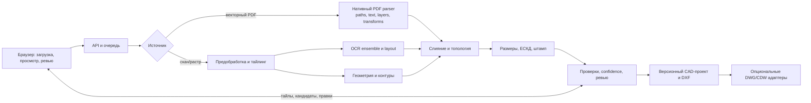

# Инженерный план: точная онлайн-реконструкция 2D-чертежей

Статус: план, без реализации. Связанная задача: [#2](https://github.com/kappamaag-crypto/CadRecon/issues/2). Обновлено: 2026-11-16.

## Цель и границы результата

CadRecon должен стать веб-системой, которая принимает PDF, TIFF, PNG и JPEG, выделяет редактируемую 2D-модель чертежа, показывает степень достоверности каждого объекта и экспортирует проверенный результат. Приоритет — **онлайн-версия с максимальной практически достижимой точностью**; локальный Ultra-режим дополняет её для конфиденциальных, тяжёлых и сложных листов.

Результат: DXF как основной открытый формат; DWG — только через легально подключённый SDK/конвертер; CDW — через отдельный Windows-коннектор к лицензированному API КОМПАС-3D. До появления коннекторов пользователь получает проверенный DXF и понятный путь открытия/сохранения в целевой CAD.

Нельзя обещать 100% восстановление любого скана. Потерянные, размытые, перекрытые или неоднозначные элементы остаются кандидатами с причиной и confidence, а не превращаются в выдуманную геометрию. Производственный выпуск требует инженерного подтверждения и нормоконтроля.

## Текущее состояние

Клиент React/Vite уже извлекает пути и текст цифровых PDF через PDF.js, использует Tesseract.js и экспортирует DXF R2000. В `src/model.ts` есть LINE, POLYLINE, CIRCLE, ARC, TEXT, DIMENSION, оси, выноски, штриховки, таблицы, штамп и 12 типов ЕСКД. Локальный FastAPI backend добавляет PaddleOCR PP-OCRv5 и OpenCV LSD/Hough. Размерные цепи строятся как кандидаты из OCR и выносных линий.

Пробелы: нет объектной модели POINT/RECTANGLE, trim/extend/chamfer/fillet, устойчивого command history, ансамбля распознавания, графа топологии, серверной очереди, эталонных метрик и прямых DWG/CDW writer-ов.

## Целевая архитектура

### Отдельные конвейеры

1. **Векторный PDF:** проверять наличие paths/text, извлекать команды, матрицы, clipping, толщины, цвета и глифы непосредственно из PDF. Хранить `sourceObjectId`; не трассировать рендер. Растеризовать только неподдержанные фрагменты.
2. **Скан/растр:** контролируемый DPI, deskew/перспектива/фон, перекрывающиеся тайлы, координаты исходного листа. Создавать несколько гипотез и направлять спорные участки на ревью.
3. **Смешанный PDF:** сливать нативные и растровые результаты; нативному объекту дать приоритет, конфликт отображать пользователю.

## Онлайн-версия — первоочередная

- API-шлюз с проверкой типов/лимитов, антивирусной проверкой, короткоживущей загрузкой и идентификатором задания.
- Очередь с идемпотентностью, CPU/GPU лимитами, безопасным retry, прогрессом «страница → тайл → модель → проверка», отменой и приоритетами.
- Зашифрованное хранилище с TTL по умолчанию, явным удалением, tenant isolation и аудитом доступа. Никакого обучения на чертежах без отдельного согласия.
- Потоковый интерфейс: тайлы и структурированные кандидаты появляются по готовности; инженер принимает, отклоняет, объединяет или исправляет объект до окончания документа.
- Версия pipeline, модели, параметров, source/provenance и правок сохраняется с каждым объектом для воспроизводимости.
- Наблюдаемость без содержимого КД: latency, GPU/RAM, ошибки, ручные исправления, quality metrics; образцы — только opt-in.

## Конвейер максимальной точности

### Подготовка растра

Определять формат листа, рамку, DPI и качество. Строить обратимые варианты: оригинал, normalised contrast, бинаризация, удалённый фон. Исправлять skew/perspective по рамке и длинным линиям, сохраняя матрицу. Низкое качество направлять в Ultra/ручную очередь, а не повышать confidence.

### OCR, таблицы, штамп

- Browser OCR остаётся приватным quick-путём; в online accurate — серверный детектор, ориентация, полигональные bbox и распознавание.
- Основной кандидат: PaddleOCR 3.x / PP-OCRv5 `ru`/East-Slavic для русского, цифр и латиницы; CPU/GPU profiles. Метрика модели не подменяет benchmark CadRecon.
- Добавить второй независимый движок/модель как опциональный ensemble и domain-specific дообучение только на легально размеченных данных. Хранить варианты, score и правило выбора; конфликт — человеку.
- Отдельно извлекать таблицы, штамп, дроби, `Ø`, `±`, `°`, шероховатость, резьбы, GD&T. Не заменять неизвестный знак похожим Unicode без флага сомнения.
- Языковую модель применять только для ранжирования/нормализации, никогда для дорисовки цифр или размеров.

### Геометрия и топология

- Сегментация: текст, размерные/выносные, осевые, контур, штриховка, рамка/штамп, изображения, шум. Маскировать текст консервативно.
- Детекторы: LSD/Hough для кандидатов, контуры/subpixel fitting, RANSAC прямых/окружностей, arc/ellipse fitting, junction detection. У каждого примитива — residual, источник, confidence.
- Сводить фрагменты в planar graph: adaptive snap, collinear merge, intersections, gaps, duplicates, tangency, closed loops. Граф — основа trim/extend и проверок.
- Вводить типы: POINT, LINE, POLYLINE, RECTANGLE, CIRCLE, ARC, ELLIPSE, SPLINE, HATCH, BLOCK/INSERT. Полилиния сохраняет дуговые сегменты.
- Не объединять штриховку, размеры и контур только из-за касания пикселей: учитываются тип линии и семантический слой.

### ЕСКД и размерные цепи

Сопоставлять текст, стрелки, размерные и выносные линии через граф близости и правила направления. Создавать кандидаты линейного, углового, радиального, диаметрального, базового и координатного размеров; хранить указанное/измеренное значение, допуск, базу, связи и статус `candidate/reviewed/verified/rejected`.

Контроль: замкнутость цепи, сумма составляющих/общий размер, калибровка, дубли/противоречия, `Ø/R/M`, стрелки/выноски, пересечения текста, обязательные поля штампа и ЕСКД-наборы. Правила оформить версионируемым ruleset с тестовыми примерами; без молчаливого исправления чертежа.

## Полный 2D-редактор

Перейти к типизированным примитивам, стилям, слоям, блокам, связям и undoable-командам. Каждый объект: UUID, геометрия, стиль, provenance, confidence и audit trail. Добавить object snaps: endpoint, midpoint, center, quadrant, intersection, perpendicular, tangent, nearest; polar/ortho, сетку и ввод координат.

| Группа | Инструменты |
|---|---|
| Создание | point, line, polyline с дугой, rectangle, polygon, circle, arc (3-point/center-start-end), ellipse, spline, hatch, text/MTEXT, table, block, image underlay. |
| Изменение | move, copy, rotate, mirror, scale, offset, stretch, array, align, explode/join, свойства, слои. |
| Точная геометрия | trim, extend, break, chamfer, fillet, divide, lengthen; касания, closed polylines, undo/redo. |
| Аннотации | linear/aligned/angular/radius/diameter/ordinate dimensions, leaders, center marks, axes, допуски, шероховатость, сварка, сечения/выноски, штамп. |
| Проверка | measure, inquiry, selection filters, «до/после», confidence/conflicts, audit report. |

Команды сначала должны быть детерминированными на ручной геометрии, затем применяться к подтверждённым авто-кандидатам.

## Ultra: локальный сервер в выбранной папке

Ultra использует тот же API, но хранит и обрабатывает оригиналы локально, в native resolution, с тяжёлыми моделями/GPU. Это дополнение к приоритетному online accurate, а не публичный сервис.

1. Кнопка «Установить Ultra» скачивает подписанный bootstrapper/manifest и предлагает выбрать папку, CPU/GPU-профиль и порт.
2. Bootstrapper проверяет место, права, GPU/driver и хеши; создаёт изолированный runtime в выбранной папке, устанавливает pinned models и локальный секрет.
3. По умолчанию служба доступна только на `127.0.0.1`, содержит health/version/update/uninstall. LAN требует явного TLS, токена, allowlist и предупреждения.
4. Браузер связывается через localhost, CORS allowlist и одноразовый pairing token; передача листа подтверждается явно. Offline model bundle и diagnostic bundle обязательны.
5. Профили: Quick (browser), Online Accurate (очередь + ensemble), Ultra Local (tiled native resolution + GPU + privacy).

## Форматы

DXF — первый нормативный экспорт: units, UCS, layers, linetypes, blocks, MTEXT, DIMENSION/STYLE, HATCH, Unicode и provenance в безопасных extension data. Нужны round-trip/visual tests с независимыми читателями и AutoCAD/КОМПАС.

DWG нельзя реализовать переименованием DXF: заранее принять ADR о лицензировании, версиях и SDK/converter. CDW также закрыт: выделить Windows adapter к установленному лицензированному КОМПАС-3D/SDK и contract tests. В online режиме CDW-работа идёт локальному коннектору, не в неявный сторонний сервис.

## Внешние решения

| Решение | Проверенный фокус | Роль в CadRecon |
|---|---|---|
| Werk24 | API возвращает структурированные размеры, допуски, GD&T, материалы и штамп. | Опциональный платный adapter для сверки семантики; не источник геометрии. |
| DrawScan AI | Распознавание/структурирование чертежей и поиск по архиву. | Референс поиска; интеграция только после API/лицензии/benchmark. |
| CADSoftTools | Нативный PDF→editable DWG/DXF; raster в документации остаётся изображением. | Benchmark/возможный licensed option для vector PDF, не векторизатор сканов. |
| Digi-Keys | Браузерные PDF→DXF и DWG/DXF, заявлена локальная обработка. | Privacy/UX baseline; качество и условия проверить отдельно. |
| i2PDF | Онлайн PDF→DWG/DXF и предупреждение о зависимости от качества/структуры. | Smoke-baseline, не backend для закрытых КД. |
| Linnk AI | PDF summary/translation/mind maps, не CAD reconstruction. | Не использовать как движок геометрии/OCR. |
| iLovePDF | Универсальный PDF/OCR без CAD-реконструкции. | Только подготовка PDF/растра, не CAD-объекты. |

Внешние интеграции выключены по умолчанию, требуют согласия, раскрывают регион/TTL/цену и имеют contract tests.

## Качество и тесты

Собрать закрытый, юридически чистый, версионируемый corpus: native PDF, хорошие/плохие сканы, mixed pages, русский/латиница, ЕСКД, штампы, таблицы, резьбы, допуски и adversarial cases. Разделить train/validation/test по семействам и организациям.

- OCR: CER/WER, exact-match критических токенов, bbox precision/recall.
- Геометрия: primitive precision/recall, endpoint/center/radius/angle error в мм, topology F1, ложные соединения.
- Семантика: precision/recall/F1 размеров, цепей, ЕСКД и штампа; отдельное «не предложил ложное значение».
- Экспорт: DXF parsing, entity/layer/style counts, round-trip, visual pixel diff, открытие в целевых CAD.
- UX: доля принятых кандидатов, правки на лист, время до verified DXF, понятность confidence.
- Reliability/security: limits, cancellation, retry, tenant isolation, отсутствие содержимого в логах.

Пирамида: unit (PDF/coords/fitting/rules/DXF/CAD commands), property/fuzz, golden regression, API/queue/storage/Ultra integration, E2E «upload → review → edit → audit → export → reimport», manual acceptance инженером и нормоконтролёром. Релиз сравнивается с неизменяемым baseline; разные gates для vector PDF и scans. Одна маркетинговая «accuracy» запрещена.

## Этапы и gates

| Этап | Результат | Gate |
|---|---|---|
| 0 | ADR форматов, privacy, corpus, baseline, SLO. | Нет метрик — нет режима Accurate. |
| 1 | Векторный PDF: paths/text/layers/provenance, DXF regression. | Эталоны + два CAD-приёмника. |
| 2 | Online: API, queue, TTL, progress, review, audit, observability. | Security/load/recovery tests. |
| 3 | Скан: preprocessing, tiled OCR/geometry ensemble, topology, uncertainty UX. | Лучше baseline без роста опасных false positives. |
| 4 | CAD-core: полный 2D, snaps, commands, undo, styles/blocks. | Deterministic geometry/property/E2E tests. |
| 5 | ЕСКД/размеры: ruleset, chains, audit. | Critical semantic precision + no-silent-correction. |
| 6 | Ultra installer: folder choice, signed bootstrapper, CPU/GPU, offline. | Fresh install/uninstall/update/privacy tests. |
| 7 | DWG/CDW adapters и лицензии. | Contract tests по версиям CAD. |
| 8 | Pilot: flags, feedback, rollback. | Quality/security/cost agreed. |

Этапы 2–4 допускают частичную параллельность после этапа 0. CDW не блокирует DXF-ценность. Каждый этап оформляется отдельными issues, связанными с [#2](https://github.com/kappamaag-crypto/CadRecon/issues/2), с владельцем, артефактами, метрикой и демонстрацией.

## Риски

- Лицензии DWG/CDW — решить до обещания форматов; не reverse-engineer закрытые форматы.
- GPU/API cost — квоты, лимиты, quality profile до постановки в очередь.
- Конфиденциальность — cloud opt-in, Ultra для закрытых КД, TTL/шифрование.
- Ложная уверенность — candidates, confidence/reason, запрет auto-verified для рисковых объектов.
- Данные — независимая разметка/adjudication; тестовый набор не обучает модели.
- Операции — pinned versions, SBOM, signed updates, health checks, rollback.

## Источники (проверены при подготовке)

- [PaddleOCR PP-OCRv5](https://paddlepaddle.github.io/PaddleOCR/v3.1.0/en/version3.x/algorithm/PP-OCRv5/PP-OCRv5_multi_languages.html), [OCR pipeline](https://paddlepaddle.github.io/PaddleOCR/main/en/version3.x/pipeline_usage/OCR.html).
- [Werk24 API](https://www.werk24.io/) и [GD&T docs](https://docs.werk24.io/features/gdts.html).
- [DrawScan AI](https://duc-technologies.ru/drawscanai).
- [CADSoftTools online](https://cadsofttools.com/pdf-to-dwg-online/) и [raster limitation](https://es.cadsofttools.com/help/en/pdf_to_dwg_converter.htm).
- [Digi-Keys tools](https://digi-keys.ru/tools/), [i2PDF](https://www.i2pdf.com/pdf-to-cad), [Linnk AI](https://linnk.ai/fi/tools/pdf-to-mindmap/), [iLovePDF](https://www.ilovepdf.com/help/documentation).
- [КОМПАС-3D/SDK v24](https://help.ascon.ru/KOMPAS/24/docs/ReadMe.pdf).

Перед интеграцией повторно проверить API, лицензию, регион/TTL данных и benchmark на собственном наборе.
